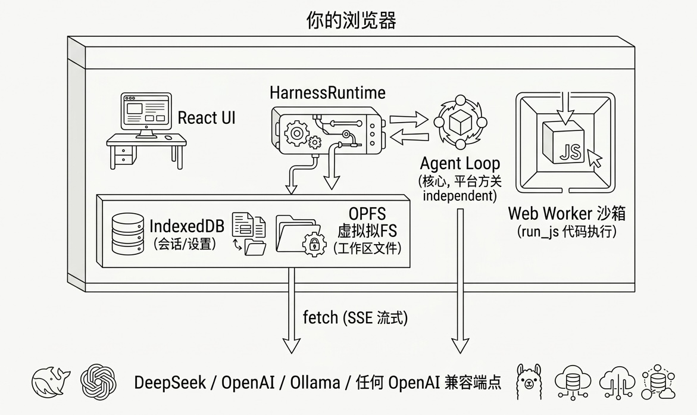

# Tim Harness

中文 | **[English](README.en.md)**

**装进一个浏览器页面的随身大模型工程 Harness。**

[](https://github.com/hongxin/tim-harness/actions/workflows/ci.yml)
[](https://github.com/hongxin/tim-harness/actions/workflows/deploy.yml)

> 🌐 **[在线演示（打开即用，无需安装）](https://hongxin.github.io/tim-harness/)** —— 自备任意
> OpenAI 兼容 API Key（DeepSeek / OpenAI / 本地 Ollama），密钥只存在你自己的浏览器里。

打开页面 → 填一次 API Key → 你就拥有一个完整的 AI 编程助手：
多轮工具调用、虚拟文件系统、代码沙箱、子代理派发——全部在你的浏览器里，零后端，零安装。



## 快速开始

```bash
cd tim-harness
npm install
npm run dev        # http://localhost:5188
```

1. 打开页面 → 点「设置」→ 选 Provider → 填 API Key
2. 给一个任务，例如：
   > 用 run_js 计算斐波那契数列前 20 项，把结果写入 fib.md，并读回来确认。

**本地 Ollama（完全离线）**：`OLLAMA_ORIGINS=* ollama serve`，Provider 选「Ollama 本地」。

## 核心特性

**🔥 极致 Token 经济** — 五层成本防线：工具输出瘦身 → 前缀缓存（DeepSeek 命中价 **1/50**，实测省 **84-90%** 输入费用）→ 视图折叠 → 增量压缩 → 成本档位一键切换。[→ 详细](docs/04-context-economy-research.md)

**🎯 目标驱动自动推进** — 设定目标后智能体自主连续执行（每轮完整 harness 循环），模型自报完成/阻塞；支持暂停/继续/轮次上限。

**⚡ 零安装零后端** — 打开网页即用。OPFS 持久化工作区、IndexedDB 会话存储、Web Worker 代码沙箱，密钥永不出浏览器。

**📦 完整工具链** — 18 个工具：文件读写/编辑/搜索、JS 沙箱、网页抓取/搜索、子代理派发、任务规划、技能系统、工作区快照（轻量 git 化）。[→ 完整列表](docs/features.md)

**🌌 多模态可视化** — 四种视图实时切换：💬 对话 / 🌌 Cosmos 星图（3D 力导向）/ 🏭 装配线（正交布线+三级折叠）/ ⚔️ 战场模式（Three.js 红警风格暴兵可视化）。[→ 可视化设计](docs/08-cosmos-design-principles.md)

<details>
<summary><b>📋 更多能力</b>（点击展开）</summary>

| 能力 | 说明 |
|---|---|
| 多模型路由 | 子代理可配更便宜的模型，主会话保持强模型 |
| 技能系统 | `/skills/<名称>/SKILL.md` 自动索引，智能体可自建技能 |
| 上下文压缩 | 水位 80% 自动 LLM 总结压缩，完整记录不受影响 |
| 工具审批 | 可选开启，写操作需人工批准 |
| 会话编辑与分叉 | 编辑重发（截断重问）、从此分叉新会话 |
| 富格式渲染 | GFM 表格、任务列表、LaTeX 公式、代码块复制 |
| HTML 实时预览 | 沙箱 iframe + 控制台捕获，设备尺寸预设 |
| 提示词双通道 | 稳定段命中前缀缓存，易变事实快照注入 |
| 微信小程序 PoC | wx 适配器验证 core 零改动移植 |

</details>

## 架构一览

```
src/
├── core/            # 平台无关核心（铁律：不 import 浏览器 API）
│   ├── runtime.ts   #   HarnessRuntime：装配 + 会话管理 + 状态机
│   ├── agent/       #   loop.ts · prompts.ts · context.ts
│   ├── llm/         #   OpenAI 兼容流式客户端 + SSE 解析
│   ├── tools/       #   18 个工具 + 注册表
│   ├── session/     #   会话模型 · 修复 · 持久化
│   └── token-economy.ts  # 三档成本策略
├── platform/        # 浏览器适配器（IndexedDB / OPFS / Worker / fetch）
└── ui/              # React 界面 + 可视化渲染器
```

**可移植性**：core 在纯 Node 中以 mock 适配器跑通 157 项断言（`npm run smoke`），
目标直达微信小程序。

## 开发命令

```bash
npm run dev         # http://localhost:5188
npm run build       # 生产构建
npm run typecheck   # strict 类型检查
npm run smoke       # core 冒烟测试（157 项）
npm run smoke:wechat # 微信 PoC 冒烟
```

## 安全说明

- API Key 仅存本机 IndexedDB，不发给 Provider 之外的任何方
- `run_js` 是计算沙箱（无 DOM、独立线程、超时终止、遮蔽同源存储 API）
- 「清空浏览器数据」会清除一切，重要内容请用导出功能备份

## 路线图

v0.4（当前）→ v0.5 多视图打磨 → **v1.0 微信小程序版**

---

📚 **[完整文档索引](docs/README.md)** · 🔬 [架构研究](docs/01-dsh-architecture-study.md) · 💰 [Token 经济](docs/04-context-economy-research.md) · 🎨 [可视化设计](docs/08-cosmos-design-principles.md)

## Star History

[](https://star-history.com/#hongxin/tim-harness&Date)
